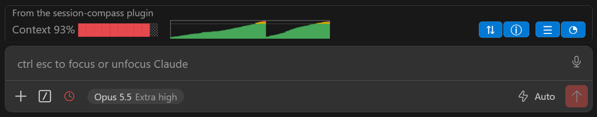
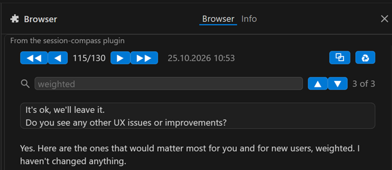
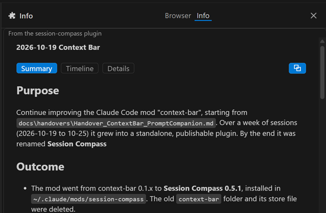

# Session Compass

**Master long sessions in Claude Code CLI, Claude Code Desktop, and the Claude Code extension for VS Code!**


- Manage your context window usage and history
- Quickly browse through the essentials of your prompts and responses
- Search your prompts and answers
- Reuse prompts
- Create and export session summaries and condensed timelines (made by
  Claude Opus, on request)
- Copy anything as Markdown

Session Compass is a [Claude Code mod](https://code.claude.com/docs/en/plugins/mods/overview).

## This mod is for you if:

- you have long conversations in Claude Code (Desktop app, CLI or VS Code extension)
- you sometimes don't know what was discussed in which session
- you continue sessions after some time and need a refresher on what was done
- you want a new or compacted session to remember the essentials of a conversation
- you want to keep the essential prompts and responses of a session for documentation, without all the details Claude adds to it
- you just need a prompt-response pair or a conversation summary as Markdown

## This mod is not for you if:

- you work only in the claude.ai chat
- you only have a few short conversations per project
- you don't know what a **context window** or **compaction** is ;-)

## Installation

**Requirements:** Claude Code 2.1.310 or later, as the VS Code extension,
the CLI, or in the Claude Desktop app, and `git` on your computer (Claude
Code uses it to download the marketplace from GitHub). Install it once: the VS Code extension, Claude Desktop and the CLI share their plugins, so Session Compass then works in all three.

### In VS Code

1. In the Claude Code panel, type `/plugins` to open **Manage plugins**.
2. On the **Marketplaces** tab, add `Chironimous/session-compass`.
3. On the **Plugins** tab, find Session Compass, click **Install** and choose
   **Install for you**.

### In the Claude Desktop app

1. In a local session of the **Code** tab, click **+** next to the prompt
   box, then **Plugins** and **Browse plugins**. The **Plugins** settings
   page opens.
2. Click **+ Add**, then **Add marketplace** and **Add from a repository**.
   Enter `Chironimous/session-compass` and click **Sync**.
3. Find Session Compass on the **Discover** tab and install it for your user
   account.

If you already added the marketplace in VS Code or a terminal, skip step 2:
the Desktop app shares its plugins with both.

### In a terminal

In a Claude Code session, run the command below, confirm the new marketplace
and choose **Install for you**:

```
/plugin install session-compass --marketplace Chironimous/session-compass
```

Or, from your shell, without a session:

```
claude plugin install session-compass --marketplace Chironimous/session-compass
```

### Check that it works

The band appears above the prompt. In a terminal, `/plugin` also shows a line
such as `1 mod active · session-compass`. If you installed from your shell
while a session was open, run `/reload-plugins` in that session.

## What it shows

Session Compass adds a band above the prompt that shows how full the context
window is and how it grew over the session. In a terminal it jumps back to
earlier prompts; in VS Code and the Desktop app it opens a conversation
browser that shows them. Everywhere, an Info pane summarizes the
conversation.

**Terminal:**

```
Context 30% ███░░░░░░░   ▁▂▂▃▃▄▅▅▆▇   ◀◀ ◀ 12/27 ▶ ▶▶   ⓘ ☰ ◔
```

**VS Code:**



| Part                      | What it does                                                                                                                                                                                                                                                                                                                                                                                                                                                                 |
| ------------------------- | ---------------------------------------------------------------------------------------------------------------------------------------------------------------------------------------------------------------------------------------------------------------------------------------------------------------------------------------------------------------------------------------------------------------------------------------------------------------------------- |
| `Context 30%` and bar   | The context window's current fill. Green below 80 %, yellow from 80 to 90 %, red above 90 %.                                                                                                                                                                                                                                                                                                                                                                                 |
| Graph                     | One point per model request of the main conversation, on a fixed 0–100 % scale of the context window.                                                                                                                                                                                                                                                                                                                                                                       |
| `◀◀ ◀ 12/27 ▶ ▶▶` | The prompt navigator: in a terminal it sits in the band, in VS Code and the Desktop app in its own pane, the [conversation browser](#the-conversation-browser). `12/27` is the current prompt of all prompts in the session. `◀` and `▶` move one prompt, `◀◀` and `▶▶` move ten, and pressing `12/27` jumps to the current prompt again. In a terminal, each press scrolls the chat so the prompt sits at the top. A new prompt moves the navigator to it. |
| `⇅`                    | In VS Code and the Desktop app, in place of the navigator: opens the [conversation browser](#the-conversation-browser).                                                                                                                                                                                                                                                                                                                                                       |
| `ⓘ`                    | Opens the [Info pane](#the-info-pane): Summary, Timeline and Details of the conversation.                                                                                                                                                                                                                                                                                                                                                                                     |
| `☰`                    | Puts `/context` into the prompt box, on a new line if you have already typed something. Press Enter to open Claude Code's context view.                                                                                                                                                                                                                                                                                                                                    |
| `◔`                    | The same for `/usage`.                                                                                                                                                                                                                                                                                                                                                                                                                                                     |

A prompt is every prompt you type and every slash command. Task notifications
and other messages Claude Code adds itself are not counted.

## The conversation browser

In VS Code and the Desktop app, Claude Code doesn't let a mod scroll the
chat, so there `⇅` opens a browser that shows one prompt and its answer at a
time.



- **Navigate** with `◀◀ ◀ n/N ▶ ▶▶`: one or ten prompts back or forward. The
  browser opens at the newest prompt and follows new ones while you stay
  there.
- **Copy** with `⧉`: the prompt and its whole answer as Markdown, under
  `# Prompt n` and `# Response n` headings. The panel doesn't let you select
  text in a mod's pane, so this is the way to copy.
- **Reuse** with `♻`: puts the prompt back into the prompt box.
- **Search** as you type: the browser counts the prompts whose text or answer
  contains your text; `▲` `▼` or Enter go to the previous or next one.
- **Images** you pasted into a prompt show as thumbnails.

**The answer** is what Claude wrote in its own voice during the turn: its
closing text and every longer text before it. Tool calls, thinking and short
interim notes ("Let me check…") are left out.

**Hide housekeeping replies:** a text that matches a rule in
`~/.claude/session-compass/.ccscignore` never counts as an answer, which
keeps, for example, the replies of a recurring `/loop` out of the browser.
One rule per line: an exact text or a `/regular expression/`; `#` starts a
comment. The file is created from the mod's `.ccscignore.def` the first time
the browser opens, and no update of the mod touches it.

## The Info pane

`ⓘ` opens a pane about the current conversation, with three tabs:



- **Summary:** purpose, outcome, key decisions, notable details and open
  items, in the language of your prompts.
- **Timeline:** topics, tasks, decisions and findings, each under the prompt
  it belongs to, plus model changes, compactions, interruptions and errors.
  `↓ n` takes you to that prompt: in the browser (VS Code, Desktop app), in
  the chat (terminal).
- **Details:** id, dates, models, token counts, number of prompts, whether the
  conversation was compacted, and what each button does.

**Summary and timeline are made on request only.** "Generate summary &
timeline" sends a digest of the conversation's prompts and answers to Claude
Opus through your own Claude Code session, **so it counts against your plan
or API usage like any other request.** A conversation of 68 prompts took
about two minutes. The pane shows the expected time beforehand and a progress
bar while it runs, and you can cancel. When the conversation has gone on
since, the pane offers "Regenerate". Very long conversations are condensed to
their most recent part, and the summary says so.

`⧉` copies the shown tab as Markdown.

The results are kept in your project, in `.ccsc/<session id>/`, so they are
there the next time you open the pane. The mod adds a `.ccsc/.gitignore`, so
git ignores the folder; delete that file if you want to commit them.

## All buttons

The VS Code panel shows no tooltips; the Info pane's Details tab has the same
table.

| Button                                  | What it does                                                                          |
| --------------------------------------- | ------------------------------------------------------------------------------------- |
| `⇅`                                  | Opens the conversation browser (VS Code, Desktop app)                                 |
| `◀◀` `◀` `n/N` `▶` `▶▶` | Ten or one prompt back or forward; `n/N` shows the current prompt again             |
| `ⓘ`                                  | Opens the Info pane                                                                   |
| `☰`                                  | Puts `/context` into the prompt box                                                 |
| `◔`                                  | Puts `/usage` into the prompt box                                                   |
| `⧉`                                  | Copies the shown prompt and answer (browser) or the shown tab (Info pane) as Markdown |
| `♻`                                  | Puts the shown prompt back into the prompt box (browser)                              |
| `▲` `▼`                           | The previous or next prompt that contains the search text (browser)                   |
| `↓ n`                                | Goes to prompt n: in the browser (VS Code, Desktop app) or in the chat (terminal)     |

## Good to know

- **Mods are new.** Claude Code's mod API is in early access and changes
  between releases, so a Claude Code update can break Session Compass until
  it is updated too.
- **Jumping in the chat** works in a terminal with Claude Code's fullscreen
  layout, the default. VS Code and the Desktop app don't allow it; the
  browser takes its place there.
- **Narrow windows:** the band and the browser leave out their less important
  parts.
- **Windows' classic console** (`conhost.exe`) lacks the graph's block
  characters and shows boxes; Windows Terminal and VS Code's terminal draw
  the graph correctly.
- **Local sessions only:** the mod needs the session's files on your
  computer, so it doesn't run in remote (cloud) or remote-controlled sessions, nor in the Desktop
  app's WSL sessions, where Claude Code loads no plugins.
- Tested on Windows and macOS, in the terminal, VS Code and the Desktop
  app's Code tab.

## Updating

Updates arrive only when you ask for them, unless you turn on auto-update:

- **VS Code:** in `/plugins`, on the **Marketplaces** tab, click the refresh
  icon next to `chironimous`.
- **Terminal:** in `/plugin`, on the **Marketplaces** tab, select
  `chironimous` and choose **Update marketplace**, or **Enable auto-update**
  to get every new version automatically.
- **Shell:** `claude plugin update session-compass@chironimous`

A session that is already open picks up the new version with
`/reload-plugins`.

## Uninstall

- **VS Code:** in `/plugins`, on the **Plugins** tab, click the trash icon on
  Session Compass's row.
- **Desktop app:** click **+** next to the prompt box, then **Plugins** and
  **Manage plugins**.
- **Terminal:** in `/plugin`, on the **Installed** tab, select Session Compass
  and choose **Uninstall**.
- **Shell:** `claude plugin uninstall session-compass@chironimous`

Uninstalling leaves the files the mod wrote. Delete them too if you like: its
store (`~/.claude/plugins/store/session-compass_*.json`), your rules
(`~/.claude/session-compass/`), and the summaries in your projects' `.ccsc/`
folders.

## What it reads and writes

Session Compass runs with your permissions, like every mod. This is
everything it touches:

- **Reads** the current session's transcript,
  `~/.claude/projects/<project>/<session-id>.jsonl` (or under
  `CLAUDE_CONFIG_DIR`), when it rebuilds a session's history and whenever the
  browser or the Info pane opens or refreshes. It streams the file through
  `cat`, or `cmd.exe /c type` on Windows.
- **Reads** the environment variables `CLAUDE_CONFIG_DIR`, `HOME`, `OS` and
  `USERPROFILE`, to find the transcript and your `.ccscignore`; `OS` also
  sizes the band in the VS Code panel, whose cells are wider on the Mac.
- **Writes** its own store, which Claude Code keeps at
  `~/.claude/plugins/store/session-compass_*.json`: one history per session
  (token counts, the first 100 characters of each prompt, each prompt's
  message id), at most 200 sessions and 2 MiB, the oldest dropped first; and
  the Info pane's recent run times, for its time estimate.
- **Writes** `~/.claude/session-compass/.ccscignore` (or under
  `CLAUDE_CONFIG_DIR`), your rules for the browser.
- **Writes** `.ccsc/` in the project the session runs in: the Info pane's
  summary and timeline, and `.ccsc/.gitignore`.
- **Calls a model** only when you press "Generate summary & timeline" or
  "Regenerate": two requests to Claude Opus through the session's own client,
  with the digest of the conversation's prompts and answers as input. It
  makes no other network requests and never submits a prompt into the
  conversation. If the prompt box refuses the text, `☰` and `◔` run the
  command directly instead.

To check this yourself, clone the repository
(`git clone https://github.com/Chironimous/session-compass`) and run
`claude plugin validate session-compass`. Its `hooks:` and `calls:` lines list
every event the mod handles and everything it asks Claude Code to do.

## License

MIT, © 2026 Chironimous. See [LICENSE](LICENSE). The bundled fast-png,
fflate and iobuffer libraries are MIT licensed too; their notices are in
`hooks/vendor/LICENSES.txt`.
